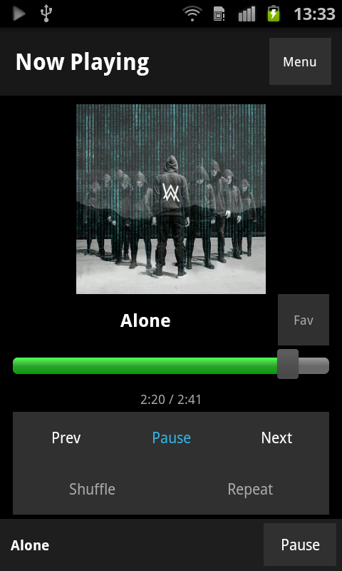
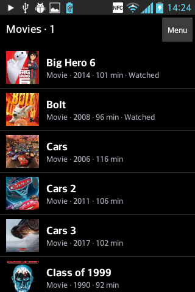

# Jellyfin Legacy Clients

Four small Jellyfin clients for older Android phones: music or movies/TV, with editions for Android 4.0.3+ and Android 1.5+. Each app has its own source repository and downloadable APK release.

## Choose an app

| App | Minimum Android | Release | Source | Tested device |
| --- | --- | --- | --- | --- |
| JellyMusic Legacy | 4.0.3 / API 15 | [1.1.0 APK](https://github.com/DerAustistYT/jellymusic-legacy/releases/latest) | [Repository](https://github.com/DerAustistYT/jellymusic-legacy) | LG E610 4.0.3; Galaxy Y CM9 4.0.4 |
| JellyVideo Legacy | 4.0.3 / API 15 | [0.3.0 APK](https://github.com/DerAustistYT/jellyvideo-legacy/releases/latest) | [Repository](https://github.com/DerAustistYT/jellyvideo-legacy) | LG E610 4.0.3 |
| JellyStone Music | 1.5 / API 3 | [0.4.0 APK](https://github.com/DerAustistYT/jellystone-music/releases/latest) | [Repository](https://github.com/DerAustistYT/jellystone-music) | Galaxy S2 GT-I9100 2.3.3 |
| JellyStone Video | 1.5 / API 3 | [0.4.0 APK](https://github.com/DerAustistYT/jellystone-video/releases/latest) | [Repository](https://github.com/DerAustistYT/jellystone-video) | Galaxy S2 GT-I9100 2.3.3 |

JellyStone is the renamed Stone Age edition. Existing Stone Age installations can update in place. Minimum Android support is established by API 3 compilation and compatible signatures; physical Android 1.5 testing is still outstanding. Confirmed playback does not mean every feature/device combination has been tested.

## Music apps

Both offer albums, songs, favorites, artists and genres; album/group navigation; cover art; search; pagination; #/A–Z jumps and pull-to-refresh. Now Playing has adaptive artwork, elapsed/total time, seeking and a favorite button. A persistent mini-player opens the full player.

Playback includes previous/next, pause/resume, queue advancement, shuffle, shuffle the full library, repeat one/all, background and screen-off playback, notification controls, and Jellyfin session reports. Download favorites provides an offline library with progress/results and internal/SD storage selection. Existing downloads and their paths are retained. Quick Connect and saved sessions are supported.

JellyStone Music brings the Legacy features to API 3 using older notification/service APIs and a small bounded artwork cache. Both use native MediaPlayer and request MP3 transcoding up to 192 kb/s, stereo, 44.1 kHz. Online songs buffer in full before starting, which can be slow. See each README for pagination/offline limits and tested details.

| JellyMusic Legacy | JellyStone Music |
| --- | --- |
|  |  |

## Movie and TV apps

Both browse movies, shows, seasons and episodes, with search, favorites, watched-state controls, continue watching/resume, Quick Connect and saved sessions. Their built-in players provide pause/resume, seeking, and controls that hide during playback and return on tapping the video.

**JellyVideo Legacy:** landscape HLS playback through a private authenticated loopback bridge, ±30-second jumps, elapsed/total time, playback-session reporting and transcoder cleanup. Quality presets are 240p, 320p and 480p. Server-side H.264 baseline/AAC transcodes stream with bounded buffers; there is no full-movie download. Library pages have 40 titles and a small cover cache.

**JellyStone Video:** native text lists with 30 titles per page. Compatible fast-start originals stream through a range proxy; otherwise roughly 20 seconds buffer first and roughly 45-second clips prefetch. Fragmented MP4 is remuxed to classic MP4 on disk for old players. The low-end preset requests up to 320×240/15 fps H.264 baseline with mono AAC. A bounded full-download fallback remains for incompatible streams.

| JellyVideo Legacy | JellyStone Video |
| --- | --- |
|  |  |

## Compatibility and installation

Install the appropriate APK from its release link and enable unknown-source installation if needed. Enter your Jellyfin server address, select Quick Connect and approve the phone's code in Jellyfin on another device. Transcoding must be allowed for formats the phone cannot decode.

All apps use the phone's built-in media decoder; CPU compatibility does not add codecs. Legacy APKs package ARMv7/ARM64/x86/x86_64 TLS support plus a Java fallback for ARMv6/native-load failures. JellyStone APKs use Java-only TLS and have no CPU-specific native libraries. HTTPS verifies certificate chains and hostnames; the Java path uses TLS 1.2 with bundled Mozilla CA roots. Keep the phone clock correct. HTTP works but is unencrypted. Private/self-signed certificates are not automatically trusted.

Old-phone RAM, codecs, server CPU and network speed affect playback. Each repository documents its exact limits and known verification gaps. This catalog contains links and screenshots; source code and APK releases live in the individual repositories.

## Contributors

Project owner and hardware testing: [DerAustistYT](https://github.com/DerAustistYT). OpenAI Codex implemented compatibility work, the clients and documentation; Anthropic Claude assisted with the original JellyMusic Legacy project. See [contributors](CONTRIBUTORS.md).
